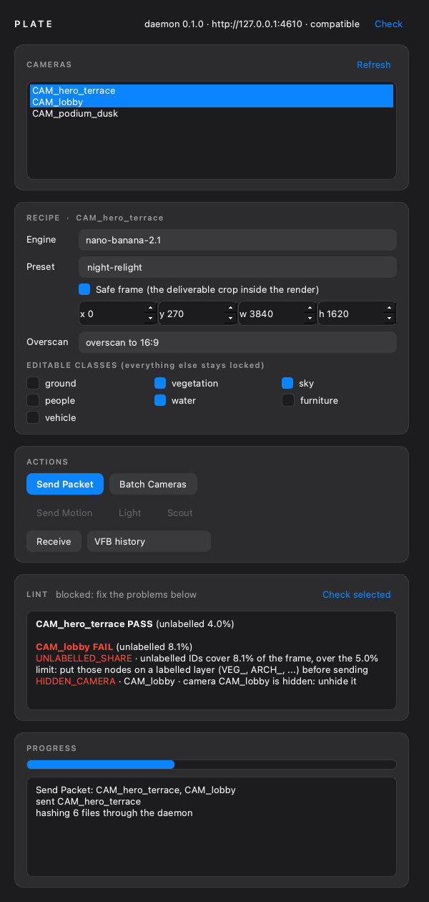

# PLATE for 3ds Max 2026

The sender side of PLATE: it reads a camera and the scene through pymxs, writes a Shot Packet folder (`spec/PACKET.md`), tells the loopback daemon where it is, and shows the result in one dock. Everything under `plate_max/` runs in Max's Python 3.11 with the **standard library only** (Qt is allowed in `plate_max/ui/`, which Max hosts). `docs/max-plugin.md` has the module map, the camera convention and the unverified-on-a-box list.



*Offscreen render of the dock against a fake controller (`plugins/max/scripts/ui_preview.py`). Dark, flat, one accent colour (the MaxGaffer house style).*

## Layout

| path | what |
|---|---|
| `plate_max/` | the headless plugin: `digest`, `legend`, `policy` (class rules, lint), `packet`, `transport` (health handshake, packet post, hashing through the daemon), `config`, `autotag`, `rt` (the only door to pymxs) |
| `plate_max/bootstrap.py` | `register_macro()` (the `PLATE_Dock` macroscript) and `launch()` (opens the dock once; a second click raises the one that is open; a failure is shown in a message box, never raised into Max) |
| `plate_max/ui/dock.py` | the PySide6 dock (`PlateDock`, `show_dock`) |
| `plate_max/ui/controller.py` | what the dock talks to: the `Controller` protocol, `LiveController` (open scene, daemon, actions) and `FakeController` (tests, preview). No Qt, so it imports and tests anywhere |
| `startup/plate_startup.py` | the Max startup script: reads `repo_path` from `config.json`, puts the plugin on `sys.path`, registers the macro. Never raises into Max, never updates anything |
| `scripts/` | `install.ps1`, `uninstall.ps1`, `install.bat`, `ui_preview.py`; read `plugins/max/scripts/README.md` before installing |
| `tests/` | the fake pymxs (`fake_pymxs.py`), scene descriptions, and the suites; `tests/test_ui_dock.py` drives the real dock offscreen |
| `maxscript/` | the client packet kit (a separate task) |

## The dock

One column, top to bottom: the daemon status line (health and version handshake, **Check** re-runs it), the camera list (multi-select), the recipe editor for the focused camera (engine, preset, safe frame, overscan aspect, editable classes; everything not ticked stays locked), the actions, the lint panel, progress and log.

- **Send Packet** and **Batch Cameras** run the same flow: handshake, then lint on every selected camera, then the send. A daemon that is down or the wrong release stops the flow before anything is rendered; any lint problem on any selected camera stops it too and lists the codes (`UNLABELLED_SHARE`, `SCALED_CAMERA`, `SHIFTED_CAMERA`, `NO_VRAY`, `HIDDEN_CAMERA`, `BAD_NAME_CHARS`, ...).
- **Receive** asks for a result file and loads it into the VFB history or as the viewport background.
- **Send Motion**, **Light** and **Scout** are disabled, with a tooltip, until their actions are wired (a later task). The dock decides by asking the controller for its capabilities, so the buttons light up by themselves when the action modules arrive.
- Threading contract (copied from MaxGaffer): every pymxs call runs on Max's main thread; the daemon health call runs on a `QThread` while the main thread spins a local event loop, so Max stays responsive and no widget is touched off-thread. Renders block Max by nature, so the log narrates and keeps the event loop alive.

The send, batch and receive actions live in `plate_max/actions/`, written by the Send/Batch/Receive task. The controller calls them through a fixed contract (documented at the top of `plate_max/ui/controller.py`) and only when the module exists.

## Install (Windows, 3ds Max 2026)

```powershell
powershell -ExecutionPolicy Bypass -File plugins\max\scripts\install.ps1 -RepoPath <your clone>
```

Restart Max, open **Customize > Customize User Interface**, category **PLATE**, and drag `PLATE_Dock` onto a toolbar or quad menu. Also read the Safe Scene Script Execution check in `plugins/max/scripts/README.md`. Uninstall with `uninstall.ps1`. Do not install or update in a delivery week.

## Develop and test on a Mac or PC

```
.venv/bin/pytest plugins/max/tests -q
.venv/bin/python plugins/max/scripts/ui_preview.py        # refresh plugins/max/dock_preview.png
```

`tests/test_ui_dock.py` skips only its dock half when the PySide6 wheel is missing (it is in the dev dependency group). Nothing here needs Max, a daemon or a network.

## Unverified on a Max box

Nothing in this folder has run inside Max yet. On the box, in order:

1. `install.ps1 -RepoPath <clone>`, restart Max: the Listener prints `[PLATE] plate_max ... loaded` and `[PLATE] macro PLATE_Dock registered`. If not: the Safe Scene Script Execution setting, then the macroscript call below.
2. `macros.new` with five arguments (category, name, tooltip, button text, script) and `python.Execute "..."` as the macro body are written from the MAXScript reference, not run. If the macro does nothing, run `import plate_max.bootstrap as p; p.launch()` in the Python listener to separate a macro problem from a dock problem.
3. The `PLATE_Dock` macro opens the dock; `qtmax.GetQMaxMainWindow()` parents it as a floating dock widget on the right. Check the fonts (`Segoe UI Variable`/`Segoe UI`), the dark palette against Max's own theme, and that the dock survives a scene reset and a second click on the macro.
4. The status line shows `compatible` against the running daemon; stop the daemon and it shows `unreachable` without freezing Max.
5. `uninstall.ps1` removes the startup script cleanly and leaves the backups.
